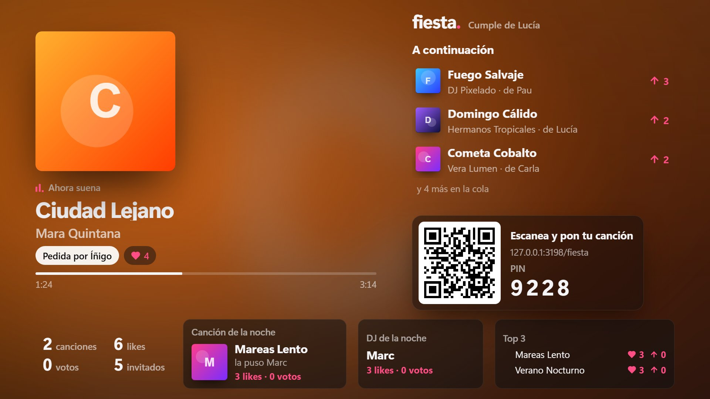
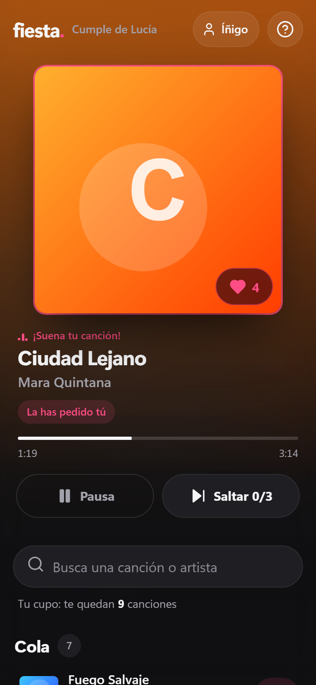
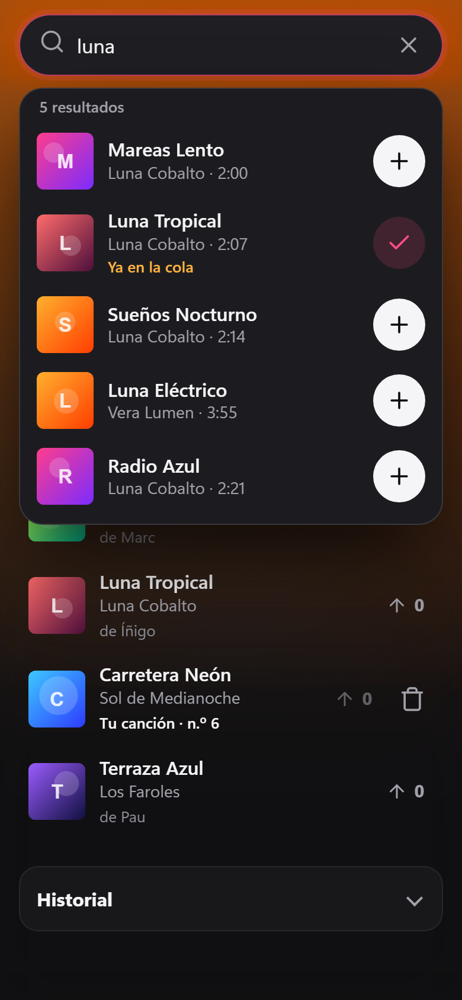
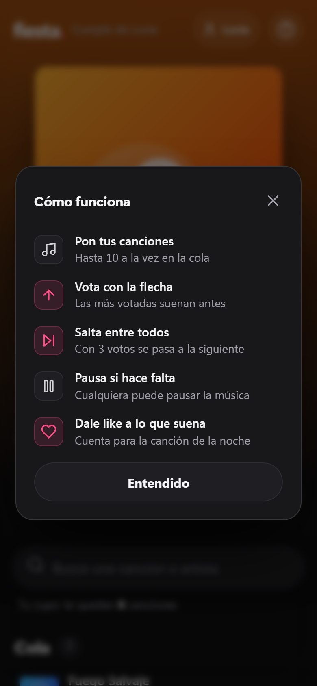
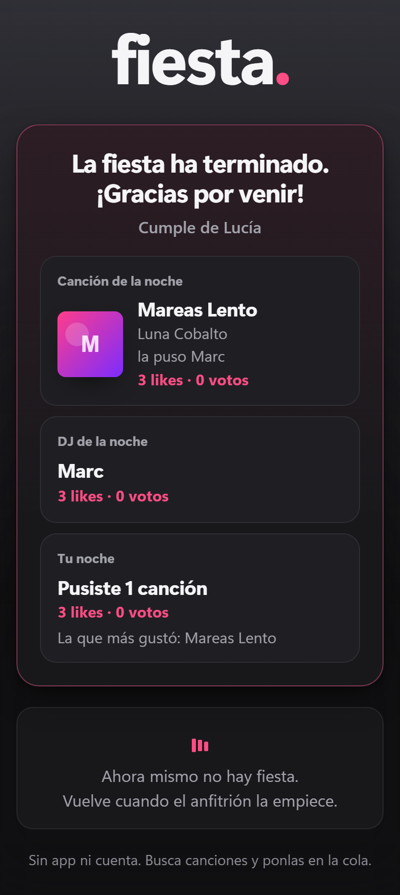
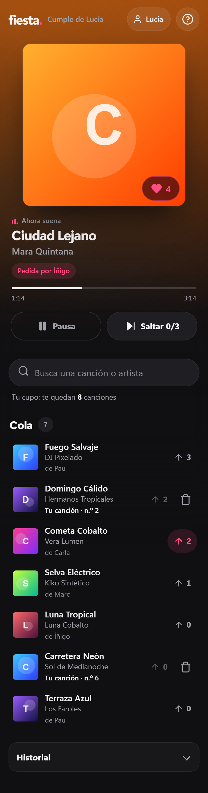
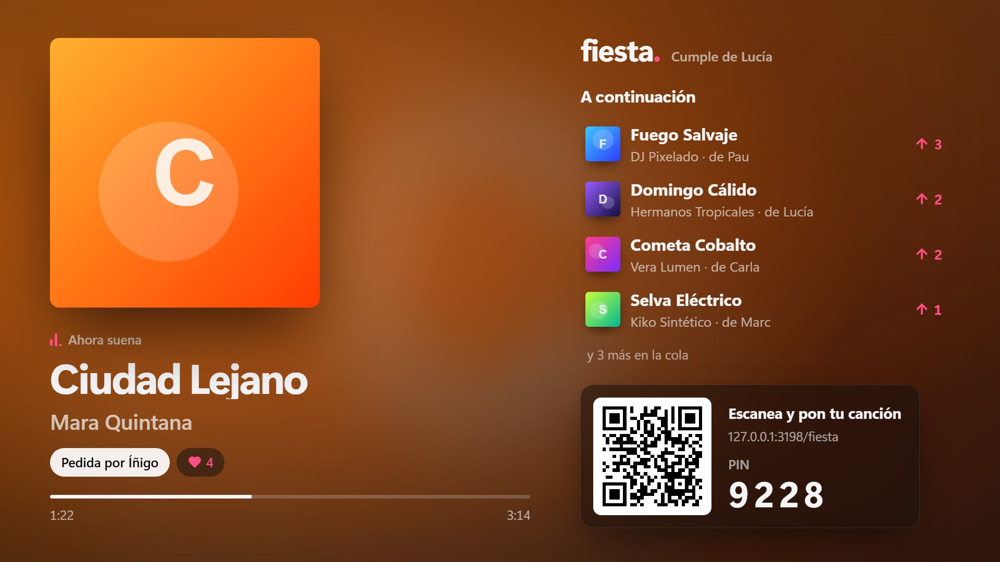
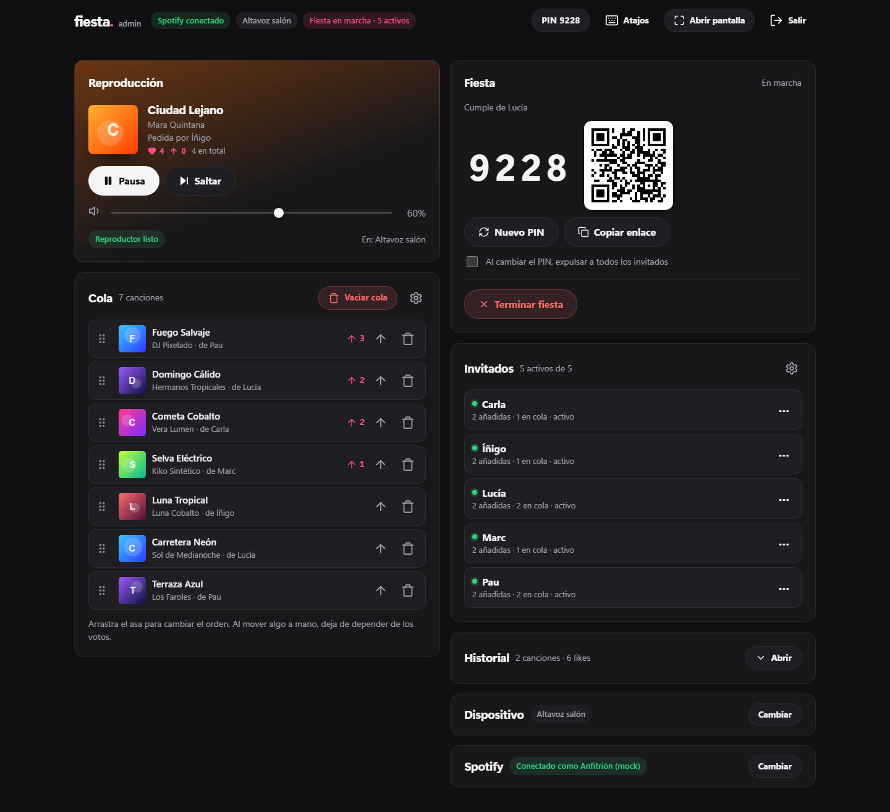

<div align="center">

# fiesta<span>.</span>

**El jukebox colaborativo para tus fiestas.**<br>
Tus invitados escanean un QR y ponen música en tu Spotify desde el móvil: sin app, sin cuenta, sin pasarse el móvil.

[](https://github.com/OskarPont/fiesta-jukebox/actions/workflows/ci.yml)


[](LICENSE)

<br>



<sub>La pantalla en la tele: lo que suena, lo que viene, el QR para entrar y el resumen de la noche.</sub>

</div>

---

## Cómo funciona

1. **Tú** abres el panel, conectas tu Spotify Premium y empiezas la fiesta.
2. **La tele** muestra lo que suena, la cola y un QR con un PIN de 4 cifras.
3. **Tus invitados** escanean, ponen su nombre y ya pueden buscar canciones, votar las que quieren antes y dar like a lo que suena.

Todo se actualiza al instante en todos los móviles, en la tele y en tu panel.

## Capturas

### En el móvil de los invitados

<table>
  <tr>
    <td align="center" width="25%"><br><sub><b>¡Suena tu canción!</b><br>Su momento, con los likes en vivo</sub></td>
    <td align="center" width="25%"><br><sub><b>Busca y añade</b><br>Con el teclado abierto y una mano</sub></td>
    <td align="center" width="25%"><br><sub><b>Cómo funciona</b><br>Las reglas, con las cifras reales</sub></td>
    <td align="center" width="25%"><br><sub><b>Despedida</b><br>Canción y DJ de la noche, y tu noche</sub></td>
  </tr>
</table>

<details>
<summary><b>Ver la pantalla principal entera</b> (lo que suena, la cola con tus puestos y el historial)</summary>
<br>
<p align="center"></p>
</details>

### En la tele

<p align="center"></p>

### En tu panel

<p align="center"></p>

## Qué incluye

**Para los invitados**
- Entrar con un QR y un PIN, sin app ni cuenta.
- Buscar canciones y ponerlas en la cola, con un cupo por persona que tú decides.
- **Votar con ↑** para que una canción suene antes, y **dar ♥** a la que está sonando.
- Ver en qué puesto va su canción y vivir **«¡Suena tu canción!»** cuando le toca.
- Saltar o pausar si tú lo permites: directo, por votos o solo tú.
- Una ayuda «Cómo funciona» con las reglas de tu fiesta y, al terminar, una **despedida** con el resumen de la noche.

**En la tele**
- Lo que suena, «A continuación», el QR y el PIN, legibles a varios metros.
- El color de la pantalla sigue a la carátula que suena.
- Opcional: una franja con el **resumen de la noche**, con la canción y el DJ de la noche y el Top 3.

**Para ti, el anfitrión**
- Un **modo fiesta**: arriba la reproducción y la cola, y cada ajuste dentro de su tarjeta.
- Reordenar la cola (arrastrando o con el teclado), subir canciones, quitarlas o vaciarla, todo **con deshacer**.
- Invitados con buscador, expulsar, banear y desbanear.
- Historial de cada fiesta con resumen, y **«Crear playlist»** en Spotify con lo que mejor funcionó.
- Atajos de teclado (pulsa <kbd>?</kbd> en el panel).

## Requisitos

- Una cuenta de **Spotify Premium**: Spotify no deja controlar la reproducción sin Premium.
- Un servidor con **Docker** y un dominio con **HTTPS** delante (Caddy, Nginx, Traefik…).
- Para probarlo en tu ordenador basta con **Node 26** (la LTS actual): hay un modo con Spotify simulado.

## Pruébalo en local (sin Spotify)

```bash
npm ci
SPOTIFY_MOCK=1 ADMIN_KEY=una-clave-local COOKIE_SECRET=un-secreto-local-de-32-caracteres npm start
```

Abre `http://127.0.0.1:3000/fiesta/admin/` y entra con la clave. Pulsa «Conectar Spotify» (en modo simulado conecta al momento) y empieza una fiesta.

| Parte | Dirección |
|---|---|
| Invitados | `/fiesta/` |
| Panel del anfitrión | `/fiesta/admin/` |
| Pantalla (TV o proyector) | `/fiesta/pantalla/` |

> En PowerShell, define las variables con `$env:SPOTIFY_MOCK='1'` (y las demás igual) antes de `npm start`.

## Instálalo en tu servidor

1. **Descarga y configura**

   ```bash
   git clone https://github.com/OskarPont/fiesta-jukebox.git
   cd fiesta-jukebox
   cp .env.example .env
   ```

   Rellena `.env`:
   - Genera `ADMIN_KEY` y `COOKIE_SECRET` con `openssl rand -base64 32`, dos valores distintos.
   - Pon tu `PUBLIC_URL`, por ejemplo `https://tu-dominio.com/fiesta`.

   El servidor no arranca si falta algo o si las claves son demasiado cortas.

2. **Arranca**

   ```bash
   docker compose up -d --build
   ```

   El contenedor solo escucha en `127.0.0.1:3000`, así que no queda expuesto a internet.

3. **Pon HTTPS delante.** Ejemplo con Caddy, que consigue el certificado solo:

   ```
   tu-dominio.com {
       reverse_proxy /fiesta* 127.0.0.1:3000
   }
   ```

   Con Nginx, desactiva el buffer para que el tiempo real funcione (`proxy_buffering off;`) y pasa `X-Forwarded-For`. Si tu proxy no está en la misma máquina ni en una red privada, pon su IP en `TRUST_PROXY`.

   Si usas una red de Docker propia, por ejemplo la de Nginx Proxy Manager, crea un `docker-compose.override.yml` (está en `.gitignore`):

   ```yaml
   services:
     fiesta:
       ports: !reset []
       networks: [proxy]
   networks:
     proxy: { external: true, name: nginx-proxy-manager_default }
   ```

4. **Conecta Spotify.**
   - En <https://developer.spotify.com/dashboard>, crea una app con tu cuenta Premium.
   - Añade como *Redirect URI* exactamente `<PUBLIC_URL>/api/spotify/callback`.
   - En el panel (`/fiesta/admin/`), pega el *Client ID* y el *Client Secret* y pulsa «Conectar Spotify».

   Las credenciales y los tokens se guardan en el volumen de datos, con permisos `600`, nunca en el repositorio.

5. **¡A bailar!**
   - Abre Spotify en el altavoz o el ordenador de la fiesta y elígelo como dispositivo en el panel.
   - Pulsa «Empezar fiesta».
   - Abre la pantalla en la tele para que todos vean el QR.

## Seguridad

- **Panel:** se protege con `ADMIN_KEY`, con límite de intentos, y una cookie firmada `HttpOnly` de 30 días. Para cerrar todas las sesiones de admin, cambia `COOKIE_SECRET`.
- **Invitados:** entran con un PIN de 4 cifras que cambia en cada fiesta. Hay límite de intentos por IP y un bloqueo global si se acumulan fallos. Si sospechas algo, genera un PIN nuevo desde el panel.
- **Baneos:** banear a alguien invalida su sesión, pero con el PIN podría volver a entrar con otra. Tras un baneo, cambia el PIN. Si te equivocas, puedes desbanear desde su menú.
- **Peticiones:** las que hacen cambios solo se aceptan en JSON y desde tu propio origen. Hay una CSP estricta y no se genera HTML con datos de los usuarios.
- **Contenedor:** corre sin root, con el sistema de archivos de solo lectura (salvo `data/`) y sin capacidades extra.
- **Copias de seguridad:** los datos (fiestas e historial, ajustes y acceso a Spotify) viven en el volumen `fiesta-data`. Copia de seguridad: `docker compose cp fiesta:/app/data ./copia-fiesta`, y guárdala en un sitio privado.

Para avisar de un fallo de seguridad, mira [SECURITY.md](SECURITY.md).

## Por dentro

- **Node 26 + Fastify**, con un frontend en JavaScript sin paso de build.
- **Tiempo real con SSE**: los móviles, la tele y el panel se enteran de cada cambio al momento.
- **Estado en JSON** dentro de `data/`, sin base de datos.
- Diseño documentado en [DESIGN.md](DESIGN.md) y producto en [PRODUCT.md](PRODUCT.md).

## Tests

```bash
npm test                          # unitarios (sin red)
npm i --no-save playwright && npx playwright install chromium
node test/e2e.mjs                 # e2e con navegador y Spotify simulado
node test/e2e-likes.mjs
```

Los e2e usan el Chromium de Playwright. Con `PW_CHANNEL=chrome` (o `msedge`) usan el navegador instalado, y con `PW_EXECUTABLE=/ruta/a/chromium`, el que indiques.

Las capturas de este README se generan solas con una fiesta de ejemplo y Spotify simulado:

```bash
npm i --no-save playwright-core
node scripts/capturas.mjs         # escribe en docs/capturas/
```

## Licencia

[MIT](LICENSE)
